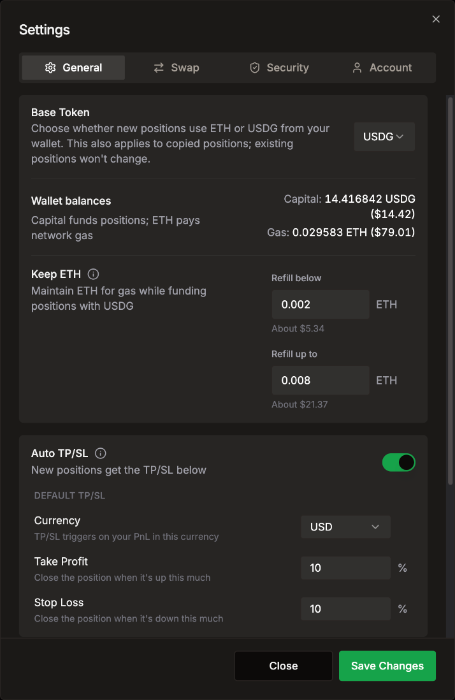
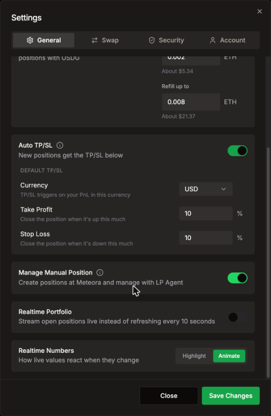
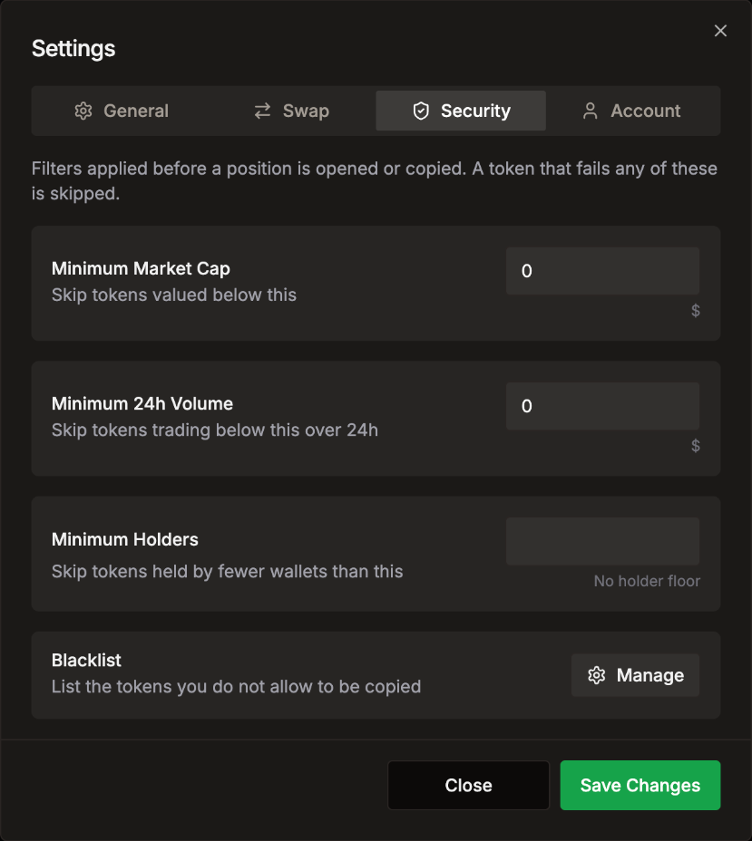

Open **Settings** from the account panel (click your address in the header). It has four tabs: **General**, **Swap**, **Security** and **Account**. Press **Save Changes** when you are done.

On an EVM account, the settings shown are for the network picked in the header's **Chain** menu (Robinhood Chain, BNB Chain or Elysium). Funding, gas and the copy guards are set per network.

The app language is not in Settings. It sits at the bottom of the account panel: see [Language](#language).

## General

<Frame>
  
  <em>General on Robinhood Chain: Base Token, wallet balances, Keep ETH and Auto TP/SL</em>
</Frame>

| Setting | What it does |
| --- | --- |
| **Base Token** (Robinhood Chain, BNB Chain, Elysium) | Fund new positions, including copies, with **ETH** or **USDG** on Robinhood Chain, **BNB** (default), **USDT** or **USDC** on BNB Chain, and **HYPE** (default) or **USDC** on Elysium. Existing positions don't change. |
| **Wallet balances** (Robinhood Chain, BNB Chain, Elysium) | Your capital (what funds positions) and your gas (ETH, BNB or HYPE). |
| **Keep ETH** (Robinhood Chain, when Base Token is USDG) | Keeps ETH topped up for gas. When ETH falls below **Refill below** (default 0.002 ETH), enough USDG is swapped to bring it back to **Refill up to** (default 0.008 ETH). |
| **Keep BNB** (BNB Chain, when Base Token is USDT or USDC) | Keeps BNB topped up for gas. When BNB falls below **Refill below** (default 0.005 BNB), enough of your stable coin is swapped to bring it back to **Refill up to** (default 0.015 BNB). |
| **Keep HYPE** (Elysium, when Base Token is USDC) | Keeps HYPE topped up for gas. When HYPE falls below **Refill below** (default 0.08 HYPE), enough USDC is swapped to bring it back to **Refill up to** (default 0.15 HYPE). |
| **Auto TP/SL** | Off by default. When on, every new position gets the default take profit and stop loss below it (10% / 10%). Copies use their own exit rules instead. See [Take Profit & Stop Loss](/features/take-profit-stop-loss). |
| **Manage Manual Position** | Lets LP Agent manage positions you open outside LP Agent, for example directly on Meteora, so you can use TP/SL on them. On by default for new accounts. |
| **Realtime Portfolio** (Solana) | Stream open positions live instead of refreshing every 10 seconds. Saved on this device. |
| **Realtime Numbers** | **Highlight** or **Animate**: how live values react when they change. On a phone, values just update, without either effect. Saved on this device. |
| **Position Sounds** | A short chime when a position opens or closes. On by default. Switching it on plays the chime once. Saved on this device. See [Notifications](/features/notifications#position-sounds). |

<Frame>
  
  <em>Manage Manual Position, Realtime Portfolio and Realtime Numbers</em>
</Frame>

## Swap

| Setting | What it does |
| --- | --- |
| **Slippage** | The most the price may move against you on a swap, in %. Applies to every swap your agent makes: zap ins, copies, closes and swap backs. A warning shows above 7%. |
| **Method** (Solana) | Which swap route to prefer: **OKX** (default) or **Jupiter Ultra**. |

On BNB Chain, swaps go through OKX for the best price, and transactions are sent through PancakeSwap's MEV Guard to protect them from front-running.

<Tip>
  If copies fail with **Price moved**, the fix in Copy Logs opens this tab with a suggested slippage. Volatile tokens usually need more room.
</Tip>

## Security

<Frame>
  
  <em>Token filters applied before a position is opened or copied</em>
</Frame>

These filters apply before any position is opened or copied. A token that fails any of them is skipped, and Copy Logs tells you which filter stopped it.

| Filter | Default for new accounts |
| --- | --- |
| **Jupiter Organic Score** (Solana) | 50 (0 to 100). Real on-chain activity of the token, with bots and sybils left out. |
| **Minimum Market Cap** | $500,000 |
| **Minimum 24h Volume** | $100,000 |
| **Minimum Holders** | 100. Set 0 for no floor. |
| **Max Pool Fee** (Robinhood Chain, BNB Chain, Elysium) | 15% for buys and sells. A copy is skipped when the pool charges this much or more each time its token is bought or sold. Each network has its own limit. |
| **Blacklist** | Tokens you never want to LP or copy. Press **Manage**, paste the token address and press **Add**. Each network has its own list. |

On BNB Chain there is also a fixed guard you can't turn off: LP Agent never buys a token that takes a tax on buys, sells or transfers, or that is flagged as a honeypot (a token you can buy but not sell). Selling is never refused.

## Account

| Setting | What it does |
| --- | --- |
| **Export Private Key** | Export your agent wallet's key. See [Account & Wallet](/account-and-wallet#export-your-private-key). |
| **Discord** | Press **Connect** to link your Discord account, so when you open a ticket on our Discord, support knows it's you and can pull up your positions. **Unlink** removes it. **Link Discord** under **Finish setup** in the account panel brings you here too. |
| **WeChat ID** | Only shown when the app is in 中文. Only the LP Agent team sees it. |
| **System Notifications** | Push notifications for take profit, stop loss and copy events, with a switch per event. See [Notifications](/features/notifications). |

## Language

LP Agent comes in English and Simplified Chinese (中文).

- **The first time you open it**, the app follows your browser's language list: if Chinese comes before English there, it opens in 中文. Otherwise it opens in English.
- **To switch**, click your address in the header to open the account panel. Near the bottom, next to **Language**, pick **EN** or **中文**. The app changes right away.
- Your pick is saved in this browser and wins over the browser language from then on.

<Note>
  The switch is in the account panel, so you need to be signed in to change it. Signed out, the app follows your browser's language.
</Note>
